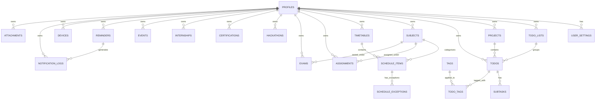

# Advanced Todo Application — Backend

Production-grade, modular monolithic backend built with **Python 3.12+**, **FastAPI**, **Pydantic v2**, **Supabase (PostgreSQL, Auth, Storage)**, and **APScheduler**.

Designed specifically to power mobile applications built with **Expo Go / React Native + TypeScript**.

---

## Table of Contents

1. [Project Overview](#project-overview)
2. [Architecture & System Design](#architecture--system-design)
3. [Database Schema Diagram](#database-schema-diagram)
4. [Tech Stack & Requirements](#tech-stack--requirements)
5. [Directory Structure](#directory-structure)
6. [Environment Variables](#environment-variables)
7. [Database Setup & Migrations](#database-setup--migrations)
8. [Running Locally](#running-locally)
9. [Running Tests](#running-tests)
10. [Docker Setup](#docker-setup)
11. [Complete API Endpoint Reference](#complete-api-endpoint-reference)
12. [Expo Mobile Client Integration](#expo-mobile-client-integration)
13. [Smart Reminder Engine & Push Notifications](#smart-reminder-engine--push-notifications)
14. [Troubleshooting & FAQ](#troubleshooting--faq)

---

## 1. Project Overview

The Advanced Todo backend manages standard productivity and academic/career lifecycles:
* **Todos & Todo Lists**: Priority levels (`LOW`, `MEDIUM`, `HIGH`, `URGENT`), statuses (`TODO`, `IN_PROGRESS`, `COMPLETED`, `CANCELLED`), postponement tracking with reschedule prompts, soft deletion, and subtask progress metrics.
* **Academic Timetable**: Weekly recurring schedules, conflict detection (`existing.start < new.end AND existing.end > new.start`), windowed recurrence projections, and date-specific schedule exceptions (`CANCELLED`, `RESCHEDULED`, `LOCATION_CHANGED`).
* **Academic & Career**: Subjects, Assignments, Exams (with multi-tier reminders: 7d, 1d, 2h), Hackathons, Certifications (expiry & exam alerts), and Internship application stages (`SAVED` → `APPLIED` → `INTERVIEW` → `OFFER`).
* **Projects & Personal Events**: Task associations with completion percentage, personal calendars.
* **Unified Calendar & Dashboard**: Single API requests providing the Expo mobile app with home screen summaries (`today`, `upcoming_deadlines`, `overdue_tasks`, `today_schedule`).
* **Smart Reminders & Expo Push**: APScheduler engine checking due reminders every 30 seconds, shifting around quiet hours, deduplicating via database constraints, and cleaning up deactivated push tokens.

---

## 2. Architecture & System Design

```text
               Expo Mobile App (React Native + TS)
                              │
                              │ HTTPS REST API (/api/v1/...)
                              ▼
        ┌──────────────────────────────────────────────┐
        │               FastAPI Backend                │
        │                                              │
        │   Routers  ──►  Schemas  ──►  Services       │
        │     │                             │          │
        │     ▼                             ▼          │
        │  Dependencies             Repositories       │
        │  (Auth / User Scoping)            │          │
        │                                   │          │
        │       APScheduler (Lifespan)      │          │
        │       - 30s Due Reminders         │          │
        │       - 5m Overdue Scanner        │          │
        └───────────────────┬──────────────────────────┘
                            │
                            ▼
              ┌───────────────────────────┐
              │      Supabase Platform    │
              │                           │
              │  ├── PostgreSQL (RLS)     │
              │  ├── Supabase Auth (JWT)  │
              │  └── Supabase Storage     │
              └───────────────────────────┘
```

### Key Architectural Principles
1. **Supabase Auth Authority**: Authentication token lifecycle, password hashing, and session validation are owned by Supabase Auth (`supabase.auth.get_user(token)`).
2. **Strict Multi-Tenant Scoping**: All routes resolve `current_user_id` from the bearer token. Repositories enforce `WHERE user_id = current_user_id`.
3. **Dual Client Model**: User requests utilize an RLS-scoped client; background scheduler operations with service-role credentials explicitly filter by `user_id`.
4. **Windowed Recurrence**: Recurring classes store base weekly rules and exceptions; occurrences are calculated dynamically in-memory for the requested date window.
5. **Database-Level Deduplication**: A unique constraint on `notification_logs(user_id, entity_type, entity_id, reminder_id, notification_type)` guarantees notifications are sent once, eliminating race conditions.

---

## 3. Database Schema Diagram



---

## 4. Tech Stack & Requirements

* **Python**: 3.12+ (tested on Python 3.14)
* **Framework**: FastAPI 0.115+
* **Validation**: Pydantic v2 & Pydantic-Settings
* **Database & Storage**: Supabase (PostgreSQL 15+, Supabase Auth, Storage buckets)
* **Scheduler**: APScheduler 3.10+
* **HTTP & Testing**: HTTPX 0.27+, Pytest 8.0+, pytest-asyncio

---

## 5. Directory Structure

```text
backend/
├── app/
│   ├── main.py                     # App initialization, middleware, routes, lifespan
│   ├── config.py                   # Pydantic v2 application settings
│   ├── dependencies.py             # Auth & user extraction dependencies
│   │
│   ├── core/                       # Core infrastructure
│   │   ├── security.py             # Supabase Auth validator & CurrentUser
│   │   ├── exceptions.py           # Custom exception hierarchy
│   │   ├── logging.py              # Structured logging with secret sanitization
│   │   ├── responses.py            # Standard API envelope builders
│   │   ├── rate_limit.py           # In-memory sliding-window rate limiters
│   │   └── idempotency.py          # Idempotency-Key 24-hour cache
│   │
│   ├── database/                   # Persistence & repositories
│   │   ├── supabase.py             # Supabase client factory (Anon & Service-Role)
│   │   └── repositories/           # Repositories with user-scoping & soft delete
│   │
│   ├── routers/                    # FastAPI routes (/api/v1/...)
│   │   ├── auth.py                 # /auth (signup, login, logout, me)
│   │   ├── users.py                # /users (profile, settings)
│   │   ├── lists.py                # /lists (CRUD, archive, restore, stats, reorder)
│   │   ├── todos.py                # /todos (CRUD, complete, postpone, subtasks)
│   │   ├── tags.py                 # /tags
│   │   ├── timetable.py            # /timetable (items, occurrences, conflicts, exceptions)
│   │   ├── subjects.py             # /subjects
│   │   ├── assignments.py          # /assignments
│   │   ├── exams.py                # /exams
│   │   ├── hackathons.py           # /hackathons
│   │   ├── certifications.py       # /certifications
│   │   ├── internships.py          # /internships
│   │   ├── projects.py             # /projects
│   │   ├── events.py               # /events
│   │   ├── reminders.py            # /reminders
│   │   ├── notifications.py        # /notifications (devices, logs, test push)
│   │   ├── attachments.py          # /attachments (storage presigned URLs)
│   │   ├── calendar.py             # /calendar (unified 8-domain query)
│   │   ├── dashboard.py            # /dashboard (home screen single payload)
│   │   ├── search.py               # /search (cross-domain ILIKE search)
│   │   └── analytics.py            # /analytics/summary
│   │
│   ├── schemas/                    # Pydantic v2 schemas
│   ├── services/                   # Business logic layer
│   ├── scheduler/                  # APScheduler jobs & runner
│   │   ├── scheduler.py            # AsyncIOScheduler runner
│   │   └── jobs.py                 # 30s reminder worker & 5m overdue scanner
│   └── utils/                      # DateTime, recurrence, and pagination
│
├── tests/                          # Automated Pytest suite (29 tests, 100% pass)
├── supabase/
│   ├── migrations/                 # 001_initial_schema.sql, 002_rls_policies.sql, 003_indexes.sql
│   ├── seed.sql                    # Development sample dataset
│   └── seed_dev.py                 # Python seeding utility
├── .env.example
├── Dockerfile
├── docker-compose.yml
├── pytest.ini
├── requirements.txt
└── README.md
```

---

## 6. Environment Variables

Copy `.env.example` to `.env` in `backend/`:

```bash
cp .env.example .env
```

| Variable | Required | Description |
| :--- | :--- | :--- |
| `SUPABASE_URL` | Yes | Your Supabase project URL (`https://xyz.supabase.co`) |
| `SUPABASE_ANON_KEY` | Yes | Public Supabase anonymous key |
| `SUPABASE_SERVICE_ROLE_KEY` | Yes | Secret Supabase service-role key (used only by scheduler) |
| `EXPO_ACCESS_TOKEN` | Optional | Expo access token for push notifications |
| `APP_ENV` | No | Environment (`development`, `production`, `testing`) |
| `API_PREFIX` | No | API prefix (defaults to `/api/v1`) |
| `LOG_LEVEL` | No | Log verbosity (`INFO`, `DEBUG`, `WARNING`) |
| `REMINDER_CHECK_INTERVAL_SECONDS` | No | Seconds between reminder checks (defaults to `30`) |

---

## 7. Database Setup & Migrations

In the Supabase SQL Editor:
1. Run `supabase/migrations/001_initial_schema.sql` (Creates 22 tables).
2. Run `supabase/migrations/002_rls_policies.sql` (Enables Row Level Security on all tables).
3. Run `supabase/migrations/003_indexes.sql` (Creates query and scheduler performance indexes).
4. *(Optional)* Run `supabase/seed.sql` to populate sample college data.

---

## 8. Running Locally

```bash
# 1. Navigate to backend directory
cd backend

# 2. Install dependencies
pip install -r requirements.txt

# 3. Start development server with auto-reload
python -m uvicorn app.main:app --host 0.0.0.0 --port 8000 --reload
```

* Swagger Interactive UI: [http://localhost:8000/docs](http://localhost:8000/docs)
* Redoc Documentation: [http://localhost:8000/redoc](http://localhost:8000/redoc)
* Health Check: [http://localhost:8000/health](http://localhost:8000/health)

---

## 9. Running Tests

The test suite uses repository abstractions and can run **100% offline** without needing cloud credentials:

```bash
cd backend
python -m pytest -v
```

Output:
```text
============================= test session starts =============================
collected 29 items
tests/test_assignments.py::test_assignment_crud PASSED                   [  3%]
tests/test_auth.py::test_health_check PASSED                             [  6%]
...
tests/test_todos.py::test_subtasks_and_progress PASSED                   [100%]
============================= 29 passed in 0.74s ==============================
```

---

## 10. Docker Setup

### Building and Running the Image

```bash
# Build
docker build -t advanced-todo-backend .

# Run
docker run -d -p 8000:8000 --env-file .env --name todo_backend advanced-todo-backend
```

### Using Docker Compose

```bash
docker-compose up -d
```

---

## 11. Complete API Endpoint Reference

All endpoints are prefixed with `/api/v1`:

### Authentication & Users
* `POST /auth/signup`: Create user account.
* `POST /auth/login`: Authenticate and receive JWT bearer tokens.
* `POST /auth/logout`: Invalidate session.
* `GET /auth/me`: Get current authenticated user.
* `GET /users/profile` & `PUT /users/profile`: Read/update user profile.
* `GET /users/settings` & `PUT /users/settings`: Read/update quiet hours, timezone, and reminder preferences.

### Todos & Lists
* `GET /lists`, `POST /lists`: List & create todo lists.
* `GET /lists/{id}`, `PUT /lists/{id}`, `DELETE /lists/{id}`: List CRUD.
* `POST /lists/{id}/archive`, `POST /lists/{id}/restore`: Archive controls.
* `POST /lists/reorder`: Reorder list priority.
* `GET /lists/{id}/stats`: Get completion stats for a list.
* `GET /todos`: Filter by list, project, status, priority, search text with pagination.
* `POST /todos`: Create todo (supports `Idempotency-Key` header).
* `GET /todos/{id}`, `PUT /todos/{id}`, `DELETE /todos/{id}`: Todo CRUD.
* `POST /todos/{id}/complete`: Complete task, cancel active reminders.
* `POST /todos/{id}/reopen`: Reopen task.
* `POST /todos/{id}/cancel`: Cancel task.
* `POST /todos/{id}/postpone?minutes=1440`: Postpone task (tracks `postponed_count`).
* `POST /todos/{id}/reschedule`: Set new due date and recalculate reminders.
* `POST /todos/{id}/subtasks`: Add subtask.
* `PUT /todos/subtasks/{subtask_id}`, `DELETE /todos/subtasks/{subtask_id}`: Manage subtasks.
* `GET /tags`, `POST /tags`, `DELETE /tags/{id}`: Tag management.

### Academic & Timetable
* `GET /subjects`, `POST /subjects`, `GET /subjects/{id}`, `PUT /subjects/{id}`, `DELETE /subjects/{id}`: Academic subject CRUD.
* `GET /timetable`, `POST /timetable`, `GET /timetable/active`: Timetable CRUD.
* `GET /timetable/conflicts/check`: Checks for time overlaps on day of week without rejecting.
* `GET /timetable/items`, `POST /timetable/items`: Manage recurring classes.
* `GET /timetable/occurrences?start_date=YYYY-MM-DD&end_date=YYYY-MM-DD`: Windowed recurrence expansion with exceptions applied.
* `POST /timetable/exceptions`: Create single-day class exceptions (`CANCELLED`, `RESCHEDULED`, `LOCATION_CHANGED`).
* `GET /assignments`, `POST /assignments`: Assignments with 24-hour reminder scheduling.
* `GET /exams`, `POST /exams`: Exams with multi-tier reminders (e.g. 7d, 1d, 2h).

### Career & Projects
* `GET /hackathons`, `POST /hackathons`: Track registration and submission deadlines.
* `GET /certifications`, `POST /certifications`: Track exam dates and expiration alerts.
* `GET /internships`, `POST /internships`: Track application deadlines and interview stages.
* `GET /projects`, `POST /projects`: Track projects with automated task metrics.
* `GET /events`, `POST /events`: Manage personal events with start-time alerts.

### System, Calendar & Notifications
* `GET /calendar?start=YYYY-MM-DD&end=YYYY-MM-DD`: Unified aggregation across all 8 domains.
* `GET /dashboard`: Single payload providing mobile home screen metrics.
* `GET /search?q=query`: Cross-table search across all 9 user-owned entities.
* `GET /analytics/summary?period=today|this_week|this_month`: Productivity statistics.
* `POST /attachments/upload-url`, `POST /attachments/record`: Supabase Storage upload flow.
* `POST /notifications/devices`: Register Expo push token.
* `GET /notifications/devices`, `DELETE /notifications/devices/{id}`: Manage device tokens.
* `GET /notifications/logs`: Notification delivery logs.
* `POST /notifications/test`: Send immediate test push notification.

---

## 12. Expo Mobile Client Integration

### 1. Registering Device Token
In your React Native / Expo application, fetch the Expo Push Token using `expo-notifications` and register it:

```typescript
import * as Notifications from 'expo-notifications';

async function registerForPushNotifications(authToken: string) {
  const tokenData = await Notifications.getExpoPushTokenAsync();
  const pushToken = tokenData.data;

  await fetch('https://your-api.com/api/v1/notifications/devices', {
    method: 'POST',
    headers: {
      'Content-Type': 'application/json',
      'Authorization': `Bearer ${authToken}`,
      'Idempotency-Key': pushToken, // Prevents duplicate registration
    },
    body: JSON.stringify({
      expo_push_token: pushToken,
      platform: Platform.OS, // 'ios' | 'android'
      device_name: `${Device.manufacturer} ${Device.modelName}`,
    }),
  });
}
```

### 2. Loading the Dashboard
Load all home screen data in a single request:

```typescript
const response = await fetch('https://your-api.com/api/v1/dashboard', {
  headers: { 'Authorization': `Bearer ${userToken}` }
});
const dashboard = await response.json();
console.log(dashboard.today); // { completed: 5, pending: 4, overdue: 1 }
console.log(dashboard.today_schedule); // Today's classes
console.log(dashboard.upcoming_deadlines); // Next 7 days deadlines
```

---

## 13. Smart Reminder Engine & Push Notifications

* **APScheduler Integration**: Periodic worker runs every 30 seconds (`process_due_reminders`).
* **Quiet Hours Shifting**: If a user's quiet hours are enabled (e.g. 22:00 to 07:00 in `Asia/Kolkata`), reminders falling in that interval are automatically shifted to `07:00` local time.
* **Database Deduplication**: Prevent duplicate notifications across multiple triggers with unique database constraints.
* **Dead Token Deactivation**: When the Expo Push API returns `DeviceNotRegistered`, the dead push token is automatically deactivated in the database (`is_active = False`).
* **Overdue & Postpone Detection**: A 5-minute background job detects overdue items and tasks postponed 3+ times, offering reschedule prompts.

---

## 14. Troubleshooting & FAQ

* **401 Unauthorized**: Ensure the `Authorization` header has the format `Bearer <supabase_access_token>`.
* **422 Validation Error**: Request bodies validate strict formats (e.g., ISO-8601 datetimes, `end_time > start_time`).
* **Timezones**: Timestamps are stored in UTC (`timestamptz`). Set the user's timezone via `PUT /api/v1/users/settings` (e.g. `Asia/Kolkata`, `America/New_York`) for accurate quiet hours and occurrence calculations.
